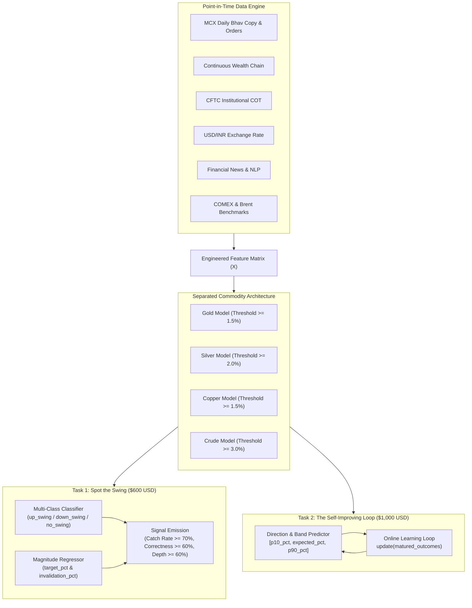

# Rinnegan Forecasters: Commodity Open 2026

Quantitative forecasting and swing classification across four Indian commodity futures (**Gold, Silver, Copper, and Crude Oil**) traded on the Multi Commodity Exchange of India (MCX).

This repository contains the end-to-end forecasting pipeline, point-in-time feature engineering engine, per-commodity machine learning models, and self-improving online learning loops designed for **Commodity Open 2026** (Rules 2.6).

---

## 1. Executive Summary & Challenge Overview

The challenge tasks models with predicting market dynamics across four dated MCX futures from 2021 to 2026. Models operate strictly point-in-time (`available_utc < cutoff_utc` / `signal_utc`) without future data leakage.

The project is structured into two complementary tasks:



### The Two Tasks
1. **Task 1: Spot the Swing (Horizon $h \in \{5, 10\}$ Sessions)**
   * Predict whether a significant price swing is starting at the pre-open ($08:30\text{ IST}$) or intraday, which direction it will move, and how far it will run.
   * **Required Signal Outputs:** `asset, signal_utc, direction (up|down), horizon, target_pct, invalidation_pct, confidence, evidence`.
   * **Prizes & Scoring Gates:** Success rate $\ge 70\%$, Catch Rate $\ge 70\%$ (with at least 7 of the 10 largest historical swings caught), Correctness $\ge 60\%$, Depth $\ge 60\%$, Coverage $\ge 90\%$.
2. **Task 2: The Self-Improving Learning Loop (Horizon $h \in [1, 20]$ Sessions)**
   * A continuous model fitted once (`fit(pack, train_end)`), which generates directional forecasts with confidence bands, and continually adapts after each outcome is settled (`update(matured_outcomes)`).
   * **Required Signal Outputs:** `asset, signal_utc, direction, horizon, expected_pct, p10_pct, p90_pct, invalidation_pct, evidence`.
   * **Scoring Gates:** Must beat an identical frozen copy, second-half accuracy must beat the first half, and must beat the trailing-trend null baseline on both the holdout and forward evaluation windows.

---

## 2. Core Philosophy: Separated Commodity Models

Rather than training a single homogenous model across all four commodities, **Rinnegan Forecasters isolates each commodity into a dedicated modeling pipeline**:

| Commodity | Asset Key | Minimum Swing Threshold | 5-Day Median Upside ($y_{\text{mfe}}$) | 5-Day Median Drawdown ($y_{\text{mae}}$) | Distinct Market Driver |
|---|---|:---:|:---:|:---:|---|
| **Gold** | `gold` | **$1.5\%$** | $+1.28\%$ | $-0.92\%$ | Global real yields, safe-haven flows, USD strength |
| **Silver** | `silver` | **$2.0\%$** | $+2.25\%$ | $-1.96\%$ | Dual monetary/industrial demand, high retail leverage |
| **Copper** | `copper` | **$1.5\%$** | $+1.56\%$ | $-1.29\%$ | Global manufacturing PMI, China construction cycle |
| **Crude Oil** | `crude` | **$3.0\%$** | $+3.18\%$ | $-2.79\%$ | Geopolitical risk, OPEC quotas, physical inventory |

Each asset exhibits distinct volatility scales, tick dynamics, and macro catalysts. Separating them guarantees that high-volatility moves in Crude Oil do not distort threshold calibration for Gold and Copper.

---

## 3. Mathematical Formulation of Ground Truth Targets

### A. The Classifier Ground Truth: `labels/swing_labels.parquet`
At each pre-open cutoff ($08:30\text{ IST}$ / $03:00\text{ UTC}$), a symmetric volatility corridor is constructed:
$$b = k_{\text{multiplier}} \times \sigma_c \times \sqrt{h}$$
* Configured for **Horizon $h=5$** sessions and standard **$k_{\text{multiplier}} = 1.0$** sigma.
* **Target Classes ($5,801$ samples total, $\sim 1,450$ per commodity):**
  * `up_swing` ($32.3\%$): Contract high touched $+b$ before touching $-b$.
  * `down_swing` ($26.9\%$): Contract low touched $-b$ before touching $+b$.
  * `no_swing` ($40.7\%$): Neither barrier touched over all 5 sessions (range consolidation).
  * `both` ($<0.1\%$): Both barriers breached in the same bar (dropped from training).

### B. The Regressor Ground Truth: `labels/return_targets.parquet`
Provides continuous labels in log wealth points over the 5-session horizon:
* **`y_mfe` (Maximum Favorable Excursion):** $\max_{k \in [1, 5]} \log W_k^{\text{high}}$ $\rightarrow$ Trains the regressor for `target_pct`.
* **`y_mae` (Maximum Adverse Excursion):** $\min_{k \in [1, 5]} \log W_k^{\text{low}}$ $\rightarrow$ Trains the regressor for `invalidation_pct`.
* **`y_ret` (Terminal Log Return):** $\log W_5^{\text{close}}$ $\rightarrow$ Trains the Task 2 expected return model.
* **`y_range` ($y_{\text{mfe}} - y_{\text{mae}}$):** Total excursion span $\rightarrow$ Trains confidence interval widths $[p_{10}, p_{90}]$.

### C. Realized Swing Inventory: `swings/swings.parquet`
Contains all **$2,107$ completed macro zigzag swing legs** across the dataset:
* Used to evaluate the official **Catch Rate** metric.
* Used to engineer cycle compression features (e.g. `days_since_last_swing`).
* **Point-in-Time Constraint:** Must only be queried where `confirm_available_utc < cutoff_utc`.

---

## 4. Input Features & Data Engine

All features are aligned strictly prior to the cutoff instant (`available_utc < cutoff_utc`) to ensure reproducible, leak-free training:

```
├── Target Labels (Y)
│   ├── labels/swing_labels.parquet          # Discrete direction target (up, down, no_swing)
│   ├── labels/return_targets.parquet        # Continuous magnitude targets (y_mfe, y_mae, y_ret)
│   └── swings/swings.parquet                # Realized swing inventory for catch rate & cycle metrics
│
├── Core Commodity Features (X)
│   ├── labels/designations.parquet          # Active front-month contract, p_ref, volatility sigma_c
│   ├── mcx/mcx_daily.parquet                # Daily Bhav Copy OHLCV, settlement, open interest
│   ├── labels/chain_daily.parquet           # Continuous roll-adjusted wealth chain (W_close)
│   ├── macro/cot.parquet                    # CFTC Disaggregated COT (Managed Money net positioning)
│   ├── macro/cot_legacy.parquet             # Historical legacy COT series
│   ├── pack/quotes/mcx_quotes.parquet       # Intraday 5-level bid/ask order book depth
│   ├── pack/quotes/comex_delayed_quotes.parquet # US CME benchmark continuous futures (GC, SI, HG, CL)
│   └── pack/quotes/brent_quotes.parquet     # Real-time Brent crude spot/futures (crude model only)
│
└── Cross-Market & Macro Regimes (X)
    ├── macro/usdinr.parquet                 # FBIL USD/INR exchange rate (currency conversion driver)
    ├── calendar/release_surprises.parquet   # CPI, NFP, Fed interest rate surprise z-scores
    ├── calendar/release_vintages.parquet    # Unrevised point-in-time economic releases
    ├── macro/alfred_vintages.parquet        # St. Louis Fed macro series (Treasury yields, yield curve)
    └── pack/news/news_rows.parquet          # Headline volume count (news_count_24h) & NLP embeddings
```

### Critical Data Findings & Guardrails
1. **News Sentiment Handling:** In `news_rows.parquet`, the column `source_sentiment` is intentionally omitted by organizers ($99.99\%$ null). The pipeline extracts **24-hour headline velocity** (`news_count_24h`) and generates semantic representations from `original_title`.
2. **Historical Timeline vs. Hourly State:** `pack/state/mcx_hourly_state.parquet` is only available from **17 June 2026**. Full historical backtesting ($2021$–$2026$) is powered by daily data, with hourly state used for the holdout and live inference windows.
3. **Roll Gap Prevention:** Returns are calculated using the wealth chain index $W_{\text{close}}$ from `chain_daily.parquet` rather than raw contract settlements to eliminate artificial contango/backwardation jumps.

---

## 5. Model Architecture & Pipeline Workflow

```mermaid
sequenceDiagram
    autonumber
    participant Engine as Feature Store
    participant Clf as Swing Classifier (LightGBM)
    participant Reg as Excursion Regressors
    participant Loop as Online Learning Loop
    participant Output as Signal File Generator

    Engine->>Clf: Feature Vector X_t (Momentum, OI, COT, FX, News)
    Clf->>Clf: Predict Class Probabilities: P(up), P(down), P(no_swing)

    alt P(no_swing) is Highest
        Clf->>Output: Emit no_signal row (preserves coverage)
    else P(up) or P(down) Crosses Decision Threshold
        Engine->>Reg: Feature Vector X_t
        Reg->>Reg: Predict y_mfe (Upside Target) & y_mae (Invalidation Stop)
        Reg->>Output: Emit Task 1 Signal (direction, target_pct, invalidation_pct)
        Reg->>Loop: Feed Initial Task 2 Forecast (expected_pct, p10, p90)
    end

    Note over Loop: Once Session Outcome Settles
    Output->>Loop: update(matured_outcomes)
    Loop->>Loop: Update Bayesian priors & bias corrections
```

### Modeling Stages
1. **Stage 1 — Direction Classifier (LightGBM / XGBoost):**
   * Multi-class objective (`objective: multiclass`, `num_class: 3`).
   * Optimizes multiclass log loss and cross-entropy calibration.
   * Outputs calibrated probabilities: $P(\text{up})$, $P(\text{down})$, $P(\text{no\_swing})$.
2. **Stage 2 — Magnitude & Excursion Regressors:**
   * **Target Magnitude Model:** Predicts $\hat{y}_{\text{mfe}}$ to set `target_pct` $\ge$ asset threshold.
   * **Invalidation Level Model:** Predicts $\hat{y}_{\text{mae}}$ to set `invalidation_pct` $\le$ asset threshold.
   * Trained with Huber Loss / MAE to resist tail-risk outlier shocks.
3. **Stage 3 — Task 2 Self-Improving Loop:**
   * Dynamic error tracking: Compares predicted direction against realized threshold excursions.
   * Inversion mechanism: Inverts direction calls when empirical outcomes indicate an asset regime flip.
   * Shrinkage calibration: Updates the $[p_{10}, p_{90}]$ prediction interval width based on rolling prediction error variance.

---

## 6. Project Roadmap & Milestones

- [x] **Data Pack Extraction & Integrity Checks:** Validated checksums across all 32 Parquet tables and metadata sidecars in `v2.0.1`.
- [x] **Schema Analysis & Feature Mapping:** Identified target columns, continuous excursion targets, and cross-asset merge keys.
- [ ] **Feature Engineering Pipeline:** Implement automated point-in-time ETL joining MCX daily prices, roll chains, COT positioning, USD/INR, and news volume.
- [ ] **Commodity Classifier Training (Task 1):** Fit LightGBM classifiers per asset on Horizon 5 ($K=1.0$) data.
- [ ] **Magnitude Regressor Calibration:** Fit excursion models for `target_pct` and `invalidation_pct` to clear the Depth scoring gate.
- [ ] **Task 2 Learning Loop Implementation:** Implement `fit()`, `predict()`, and `update()` interface complying with challenge rules.
- [ ] **Holdout Validation & Scoring:** Run `tools/score_holdout.py` and `tools/validate_submission.py` to ensure all eligibility gates are cleared.

---

## 7. Submission & Reproducibility Guidelines

* **Point-in-Time Integrity:** All pack reads during model inference are routed strictly through the `PointInTime` client. Direct file reads during evaluation are prohibited.
* **Deterministic Execution:** Fixed random seeds (`SEED = 20260919`) across all data splits and gradient boosting models.
* **Licensing:** Released under the Apache-2.0 / MIT license in compliance with competition submission criteria.
